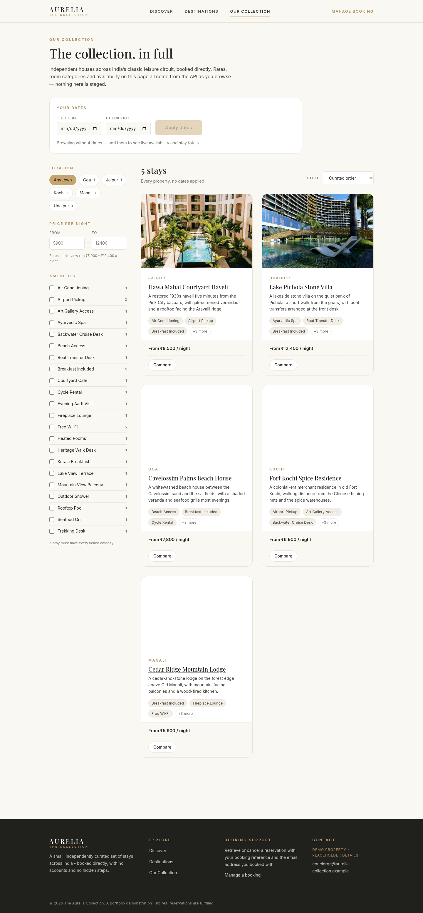
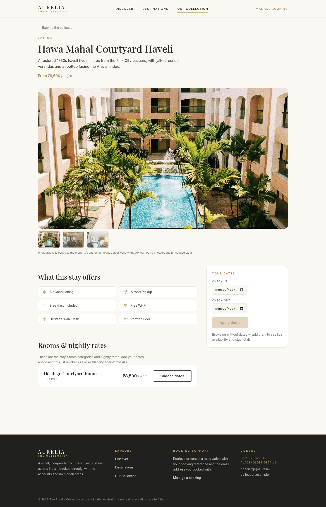
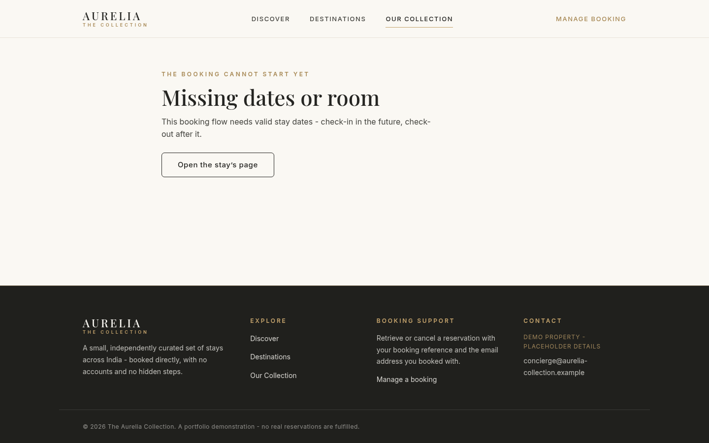
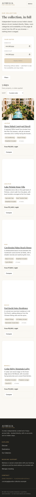

# Hotel Booking Portal

A full-stack hotel booking application: browse hotels, check date availability, book one room, retrieve and cancel reservations - built as a technical interview assignment.

**Current status:** Feature-complete (Milestone F) with the Phase 3 security remediation and the Phase 4 configuration hardening applied. The backend ships the full REST API with its automated 83-test suite - green on the H2 leg (`Tests run: 83, Failures: 0, Errors: 0, Skipped: 0`); the MySQL leg re-runs automatically in CI. The frontend (Milestones A-E) delivers the design system, homepage, collection listing with filters and compare, the hotel detail page with the four-step booking flow, and the Manage Booking page with reference+email lookup and email-verified cancellation. This README documents only what exists right now.

## Features

- **Hotel browsing and search** - five curated circuit properties with city search that matches case-blind.
- **Collection filters** - location (town chips with live counts), price-per-night range derived from the rates the API actually returned, AND-semantics amenity chips; sort by curated order or price ascending/descending.
- **Dated availability** - per-category availability for a half-open stay `[checkIn, checkOut)`; same-day turnover never conflicts.
- **Compare** - pin up to three hotels and view them side by side.
- **Booking flow** - review → guest details → price quote (exact `DECIMAL(10,2)` math) → confirmation, with client-side validation mirroring the backend's rules on the `Asia/Kolkata` clock.
- **Manage booking** - lookup by reference + email (one generic 404 for any wrong pair, email matched case-insensitively), the booking as a ledger, and email-verified cancellation with a confirmation dialog.
- **Concurrency-safe inventory** - one row-lock decision per booking; cancellation is a single atomic conditional UPDATE; the room returns to inventory the instant a booking flips to `CANCELLED`.

## Architecture

A React 18 + Vite SPA talks to a Spring Boot 3.5 REST API over JSON; Hibernate maps onto a Flyway-owned schema running on MySQL 8.4 (H2 in MySQL compatibility mode for fast development). Every failure returns one curated error envelope, every concurrency decision is made by the database under row locks, and all date arithmetic runs on the `Asia/Kolkata` business clock. The full narrative - schema, booking logic, cancellation strategy, assumptions and limitations - lives in `docs/DESIGN.md`.

## Stack (backend)

| Layer | Technology |
|---|---|
| Language | Java 21 (Temurin) |
| Framework | Spring Boot 3.5.16 (Web, Data JPA, Validation, Actuator) |
| Persistence | Spring Data JPA (Hibernate) on a Flyway-owned schema |
| Database | H2 (MySQL compatibility mode) for development, MySQL 8.4 for full local runs |
| Build | Maven 3.9 (wrapper included, no local Maven install required) |
| API docs | springdoc OpenAPI (`/swagger-ui.html`, `/v3/api-docs`) |
| Tests | JUnit 5 + AssertJ + Spring Boot Test (83 tests: database layer, REST contract, money & availability rules, booking and cancellation concurrency regressions, request throttle, response security headers, H2 console configuration) |

## Repository layout

```
backend/                       Spring Boot REST API (port 8080)
  src/main/java/com/hotelbooking/
    HotelBookingApplication.java
    api/                       hotel + booking REST controllers
    config/                    CORS allowlist, business timezone clock
    domain/                    Hotel, RoomType, Booking, BookingStatus
    dto/                       request/response records
    error/                     ApiError envelope, exception hierarchy, global handler
    repository/                Spring Data repositories (incl. pessimistic row lock)
    service/                   booking transaction, quoting, reference generator
  src/main/resources/
    application.yml            shared configuration
    application-h2.yml         default profile - embedded H2, file-persisted
    application-mysql.yml      MySQL profile - credentials from environment only
    db/migration/
      V1__schema.sql           four tables, constraints, availability index
      V2__sample_data.sql      five seeded hotels, INR pricing, amenities
      V3__hotel_images.sql     optional hotel image_url column (photography pending)
  src/test/java/               database, REST contract and concurrency tests
  src/test/resources/          test datasources: in-memory H2 (default), MySQL via profile
  docker-compose.yml           MySQL 8.4 for the local database profile
  .env.example                 environment template (copy to .env, never committed)
frontend/                     React 18 + Vite + TypeScript (Phase 5)
  src/api/                    typed client for the Spring Boot endpoints + response shapes
  src/lib/format.ts           INR formatting, night math, Asia/Kolkata business date
  src/styles/tokens.css       design tokens - the approved Option A palette
  src/styles/global.css       reset, typography base, buttons, motion rules
  src/components/layout/      header, footer, app shell
  src/components/common/      BrandMark, SmartImage (fallback-aware), PagePlaceholder
  src/components/home/        SearchPanel (validated), HotelCard, homepage sections
  src/data/imageCatalog.ts    centralized photography mapping with per-hotel notes
  src/assets/brand/           commissioned Aurelia Collection hero image
  src/assets/hotels/          ten shipped photography assets (img-1 .. img-10)
  src/pages/                  routed pages + /styleguide design-system reference
docs/
  DEPLOYMENT.md                production deployment guide (versions, env vars, checklist)
  DATABASE.md                  schema documentation and verification guide
  API.md                       REST contract, error codes, business rules
  TESTING.md                   test strategy, both database legs, what each proves
  IMAGE-INVENTORY.md           photography subjects, placements and honest pairing notes
```

## Prerequisites

- JDK 21 (`java -version` should report 21.x; newer JDKs also compile correctly since the build targets `--release 21`)
- Node.js 20+ and npm, only if you run the frontend
- That is all for the H2 profile - the Maven wrapper downloads Maven itself.
- Docker + Docker Compose, only if you want the MySQL profile.

## Frontend (Phase 5)

React 18 + Vite + TypeScript against the approved "Luxury Hotel Booking - Option A" direction. Milestone B filled the homepage: the commissioned hero photograph, a destination/date search panel wired to `GET /api/hotels/search` plus per-hotel `GET /api/hotels/{id}/availability`, the featured collection (real seeded records and INR rates via `GET /api/hotels` + detail calls) and five destination cards that run genuine searches. Milestones C and D added the collection listing (filters, sorting, dated availability, up-to-three comparison) and the hotel detail page with the four-step booking flow. Milestone E fills `/manage-booking`: lookup by reference + guest email against `POST /api/bookings/lookup`, the booking record as a ledger, and email-verified cancellation with a confirmation dialog against `POST /api/bookings/{reference}/cancel` - a wrong pair gets the same neutral not-found the API gives everyone, and nothing on the page decides availability or amounts on its own. Date validation mirrors the backend's `StayDates` rules on an Asia/Kolkata clock: past check-in rejected, check-out must fall after check-in. The dev server proxies `/api/*` to `localhost:8080`, so start the backend first:

```bash
cd frontend
npm install
npm run dev          # http://localhost:5173
```

`npm run build` runs the TypeScript compiler in strict mode and produces the production bundle in `dist/`; `npm run preview` serves that bundle on port 4173 with the same `/api` proxy, so the production build talks to the API with no CORS setup. When the frontend is deployed from a different origin than the API, set `VITE_API_BASE_URL` at build time and add that origin to the backend's `CORS_ALLOWED_ORIGINS`. The photography inventory and placement rules live in `docs/IMAGE-INVENTORY.md`; the design tokens are visualized on `/styleguide` while the dev server runs.

## Running with H2 (default profile)

```bash
cd backend
./mvnw spring-boot:run
```

On first boot the API compiles, starts on port 8080, creates `backend/data/hotelbooking.mv.db` and applies both migrations, so the database seeds itself. An existing Phase 1 database upgrades in place - migrations apply, nothing is wiped. Useful endpoints while the profile is active:

| URL | Purpose |
|---|---|
| `http://localhost:8080/actuator/health` | liveness probe, returns `{"status":"UP"}` |
| `http://localhost:8080/h2-console` | browser SQL console - **off by default**; start the app with `H2_CONSOLE_ENABLED=true` first (JDBC URL `jdbc:h2:file:./data/hotelbooking;MODE=MySQL`, user `sa`, empty password) |

The H2 profile exists for quick development. It runs H2 in MySQL compatibility mode so schema SQL and locking behaviour stay portable to MySQL.

## Running with MySQL

```bash
cd backend

# 1. Configure credentials - the compose file refuses to start without them.
cp .env.example .env
# edit .env: set DB_PASSWORD and DB_ROOT_PASSWORD (never commit this file)

# 2. Start MySQL 8.4 and wait for the healthcheck to pass.
docker compose up -d
docker compose ps        # STATUS should be "healthy"

# 3. Boot the API against it.
SPRING_PROFILES_ACTIVE=mysql ./mvnw spring-boot:run
```

Connection details resolve from the environment (`DB_HOST`, `DB_PORT`, `DB_NAME`, `DB_USERNAME`, `DB_PASSWORD`). No default password exists anywhere in the repository - set real values in `.env` before starting anything.

## Verifying the schema and seed data

Flyway is enabled and owns the schema; Hibernate is configured with `ddl-auto: none` and can never create tables.

1. Boot the API with either profile and watch the log for `Migrating schema "PUBLIC" to version "1 - schema"` and `"2 - sample data"`.
2. Open the H2 console (H2 profile) or any MySQL client and run:

```sql
SELECT version, description, success FROM flyway_schema_history ORDER BY installed_rank;
```

On the H2 console this exact statement needs H2-style quoting (see `docs/DATABASE.md` for why):

```sql
SELECT "version", "description", "success" FROM "flyway_schema_history" ORDER BY "installed_rank";
```

3. Expect three rows: Flyway's own marker (rank -1, null version, `<< Flyway Schema History table created >>`) plus versions 1 and 2 - every row with `success = TRUE`. A failed migration leaves a row with `success = 0` and the API refuses to boot until it is resolved.
4. Confirm the seed landed:

```sql
SELECT (SELECT COUNT(*) FROM hotels)         AS hotels,
       (SELECT COUNT(*) FROM hotel_amenities) AS amenities,
       (SELECT COUNT(*) FROM room_types)      AS room_types;
-- expect: 5 hotels, 30 amenities, 5 room types
```

## Tests

```bash
cd backend
./mvnw test
```

83 tests run by default against in-memory H2 in MySQL compatibility mode: the four database-layer classes from the schema work, the REST contract tests for all eight endpoints, the price and availability rule tests, the booking and cancellation concurrency regressions, the booking-endpoint request throttle, the security response headers, and the H2 console configuration hardening. Every contract and service test rolls back inside one transaction, so the suite is repeatable and order-independent; the concurrency tests bring their own fixtures and clean up after themselves. Strategy, isolation model and result interpretation live in `docs/TESTING.md`.

| Suite | What it proves |
|---|---|
| `SchemaMigrationTest` | all migrations recorded applied; all four tables exist; CHECK constraints reject impossible rows (zero-night stays, unknown statuses, cancelled-timestamp misuse, duplicate amenities) |
| `SeedDataTest` | five circuit hotels; 5-7 distinct amenities each; exactly one room category per hotel, capacity 1, positive 2-decimal price |
| `BookingRepositoryTest` | frozen-quote round-trip; duplicate reference rejected; the half-open overlap truth table; cancelled bookings release the room |
| `RoomTypeRepositoryTest` | `SELECT ... FOR UPDATE` reader works; categories listable per hotel |
| `HotelApiContractTest` | hotel endpoints over HTTP: shapes, sorted amenities, generic 404s, parameter validation, the three security response headers on live responses |
| `BookingApiContractTest` | booking endpoints over HTTP: 201/200/400/404/405/409, the five-field error envelope, identical generic 404 bodies, reference+email pairing on lookup and cancel, terminal-state lookup after cancellation, cancellation returning the room to inventory, input trimming, the 30-night maximum stay on create and quote (31 nights → 400, exactly 30 → 201) |
| `BookingConcurrencyTest` | six simultaneous POSTs fight for one room through the real stack: exactly one 201, five 409 `BOOKING_UNAVAILABLE`, one persisted row |
| `BookingCancellationConcurrencyTest` | four simultaneous cancels of one booking through the real stack: exactly one 200, three 409 `BOOKING_ALREADY_CANCELLED`; four wrong-email cancels all 404 and leave the booking alive |
| `PriceCalculationTest` | single/multi-night math; quote follows the current price; bookings freeze the agreed price; post-reprice bookings take the new price |
| `AvailabilityRulesTest` | overlaps block; half-open edges bookable; same-day turnover; cancellation releases inventory; quotes advisory, booking rechecks |
| `BookingReferenceGeneratorTest` | `HB-` format, transcribable alphabet (no 0/1/I/O), uniqueness at volume |
| `RateLimitFilterTest` | the booking-endpoint throttle driven directly with tiny budgets and a mutable clock: admission up to the limit, the 429 envelope with `Retry-After`, fresh budget at the next window, per-endpoint and per-client budgets, the disable switch |
| `SecurityHeadersFilterTest` | the response-hardening filter driven directly: exactly the three headers on every response, and headers already set before the chain runs so a short-circuited 429 is stamped too |

The identical suite runs against real MySQL 8.4 when Docker is available:

```bash
docker compose up -d            # from backend/, after .env is configured
SPRING_PROFILES_ACTIVE=mysql ./mvnw test
```

What each leg proves differs in one important way: the H2 leg verifies the booking transaction's lock-recount-compare-persist shape under H2 row locks, while only the MySQL leg exercises InnoDB's `SELECT ... FOR UPDATE` itself. Any test report should name the engine it ran on (`docs/TESTING.md` spells this out).

**Latest execution record (Phase 4 configuration hardening):** H2 leg `Tests run: 83, Failures: 0, Errors: 0, Skipped: 0` (JDK 21.0.13, Maven 3.9.9) - Milestone 1 added six configuration tests (H2 console fail-safe resolution) and left the Phase 3 tests and both concurrency regressions green. The MySQL leg re-runs automatically in CI once this lands on `main`.

**Previous record (Phase 3 security remediation):** H2 leg `Tests run: 77, Failures: 0, Errors: 0, Skipped: 0`; both GitHub Actions jobs green on push (`ababb1c`).

**Previous record (Milestone F):** both legs green on the 66-test suite - H2 leg `Tests run: 66, Failures: 0, Errors: 0, Skipped: 0`; MySQL 8.4.13 leg (Docker compose, `SPRING_PROFILES_ACTIVE=mysql`) `Tests run: 66, Failures: 0, Errors: 0, Skipped: 0`.

## Configuration notes

- **CORS:** browsers may call the API only from origins listed in `app.cors.allowed-origins` (default `http://localhost:3000` and Vite's `http://localhost:5173`, override with `CORS_ALLOWED_ORIGINS`). Unknown origins get `403` at the filter, before reaching any controller.
- **Timezone:** all date validation resolves against the `app.business-timezone` clock (`Asia/Kolkata`), never against the JVM default of the host machine.
- **Error responses:** every failure returns the curated envelope (`timestamp`, `status`, `error`, `message`, `path`); `error` is the machine-readable code the client branches on (`NOT_FOUND`, `VALIDATION_ERROR`, `BOOKING_UNAVAILABLE`, `RATE_LIMITED`, ...). See `docs/API.md` for the full code table. Spring's default payload stays stripped of internals.
- **Rate limiting:** the booking endpoints (create, lookup, quote, cancel) are throttled per client address with a fixed one-minute window (create/lookup/cancel 10, quote 30; `app.rate-limit.*`). Over budget answers `429 RATE_LIMITED` with `Retry-After`. This is single-instance defense-in-depth - a production gateway (nginx/Cloudflare/LB) is the real authority, and behind one the filter is disabled with `APP_RATE_LIMIT_ENABLED=false`.
- **Security headers:** every response - including error bodies and the throttle's 429 - carries `X-Content-Type-Options: nosniff`, `X-Frame-Options: DENY` and `Referrer-Policy: strict-origin-when-cross-origin`. The three values are fixed security standards, not tunable policy.
- **H2 console (dev-only opt-in):** `spring.h2.console.enabled` defaults to `false` everywhere; the dev profile accepts `H2_CONSOLE_ENABLED=true` to expose `/h2-console` locally for schema inspection. The MySQL profile pins it off, and the test trees pin it off again. A deployed environment must never serve the console - it is unauthenticated on the H2 dev profile.
- **Database port binding:** the local Compose file publishes MySQL as `127.0.0.1:${DB_PORT:-3306}:3306` - reachable from the host, never from the LAN. Container port, volume persistence and healthcheck are unchanged; the internal Compose network (service name `db`) is untouched, which is the path a containerized backend would use.

## Sample data

Five properties on the classic Indian leisure circuit, one room category each (capacity 1 for this release), priced per night in INR:

| City | Property | Category | Price/night |
|---|---|---|---|
| Jaipur | Hawa Mahal Courtyard Haveli | Heritage Courtyard Room | Rs 8,500 |
| Udaipur | Lake Pichola Stone Villa | Lakefront Stone Room | Rs 12,400 |
| Goa | Cavelossim Palms Beach House | Beachside Cottage | Rs 7,800 |
| Kochi | Fort Kochi Spice Residence | Colonial Veranda Room | Rs 6,900 |
| Manali | Cedar Ridge Mountain Lodge | Cedar View Cabin | Rs 5,900 |

## API surface (implemented so far)

| Endpoint | Status |
|---|---|
| `GET /actuator/health` | live |
| `GET /api/hotels`, `GET /api/hotels/{id}`, `GET /api/hotels/search` | live |
| `GET /api/hotels/{id}/availability` | live |
| `POST /api/bookings/price-quote` | live |
| `POST /api/bookings` | live |
| `POST /api/bookings/lookup` | live |
| `POST /api/bookings/{reference}/cancel` | live |

## Screenshots

Captured from the running application (Spring Boot API + Vite build), desktop 1440 px and mobile 375 px.

| | |
|---|---|
|  |  |
| *Homepage - hero, search panel, featured collection* | *Collection listing - filters, sort, compare tray* |
|  |  |
| *Hotel detail - gallery, amenities, availability* | *Booking flow - guest details, quote, confirm* |
|  |  |
| *Booking confirmation - reference and frozen figures* | *Manage booking - lookup, ledger, cancellation* |
|  |  |
| *Homepage on mobile (375 px)* | *Collection on mobile (375 px)* |

## Known limitations (updated in Phase 3)

- No authentication beyond the reference+email pair: a guest who loses both the reference and their inbox has no recovery path. The assignment scope has no accounts.
- Hotel photography: `image_url` stays NULL for every seeded property by agreement. The frontend ships a local, catalog-driven set of assets instead (see `docs/IMAGE-INVENTORY.md`) - a future database URL overrides the catalog automatically.
- No cancel-by cutoff: a stay whose check-in date has passed can still be cancelled. The spec defined no cutoff; adding one is a single service check.
- The request throttle is single-instance defense-in-depth, not distributed protection: counters live in one JVM and reset on restart, and behind a gateway every client shares the gateway's address - the production authority is a gateway-level limiter (disable the filter there with `APP_RATE_LIMIT_ENABLED=false`).
- Security headers are the fixed baseline three (nosniff, DENY, strict-origin-when-cross-origin); a Content-Security-Policy is deliberately absent while the API serves JSON only - it belongs with the first HTML-serving or auth/session surface (Phase 6).
- The concurrency regression is automated (`BookingConcurrencyTest`: six simultaneous bookings, exactly one winner). On the default H2 leg it verifies the transaction's lock-recount-compare-persist shape in MySQL compatibility mode; only the MySQL leg exercises InnoDB row locks itself, and the test report must state which engine ran.
- H2 in MySQL mode is not byte-for-byte identical to MySQL (index hint syntax, some DDL nuances, identifier casing - all documented in `docs/DATABASE.md`). The MySQL profile exists precisely to verify real behaviour; migrations are written to run on both engines, and the MySQL leg of the suite has been executed green on MySQL 8.4.13.
