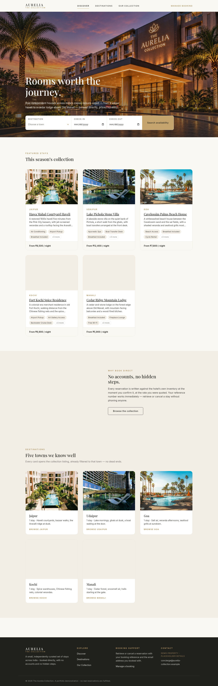
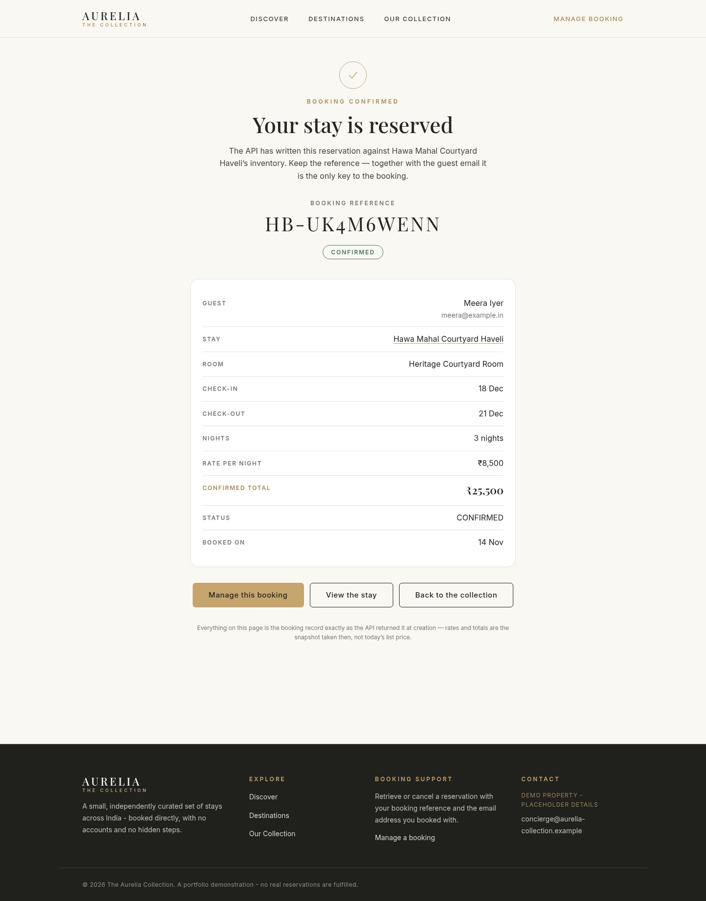
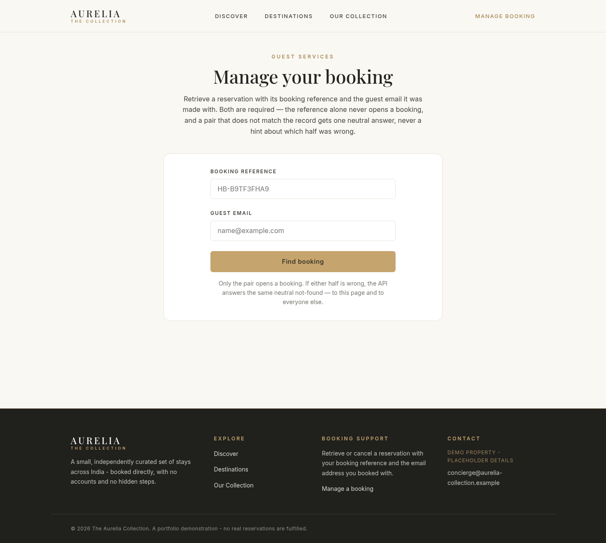

<div align="center">

# The Aurelia Collection — Hotel Booking Portal

**A full-stack hotel booking application: browse five curated properties, check dated availability, compare up to three hotels side by side, book at a server-calculated price, and manage the reservation with a booking reference plus email - built as a technical interview assignment.**

[](https://github.com/Abhisherk01/hotel-booking-portal/actions/workflows/ci.yml)
[](backend/pom.xml)
[](backend/pom.xml)
[](frontend/package.json)
[](frontend/package.json)
[](backend/docker-compose.yml)

**Status:** feature-complete (Milestone F) with the Phase 3 security remediation and the Phase 4 configuration hardening. The backend ships the full REST API with its automated 83-test suite - green on the H2 leg (`Tests run: 83, Failures: 0, Errors: 0, Skipped: 0`); the MySQL 8.4 leg runs automatically in CI on every push to `main`. The application runs locally today; there is no hosted demo, and this README documents only what exists right now.

</div>

---

## Table of contents

- [Screenshots](#screenshots)
  - [A. Home Page](#a-home-page)
  - [B. Hotel Collection](#b-hotel-collection)
  - [C. Hotel Details](#c-hotel-details)
  - [D. Booking Experience](#d-booking-experience)
  - [E. Manage Booking](#e-manage-booking)
- [Demo Video](#demo-video)
- [Features](#features)
- [Architecture and technical documentation](#architecture-and-technical-documentation)
- [Tech stack](#tech-stack)
- [Repository layout](#repository-layout)
- [Local setup (Windows PowerShell)](#local-setup-windows-powershell)
- [Sample data](#sample-data)
- [Verifying the schema and seed data](#verifying-the-schema-and-seed-data)
- [Testing](#testing)
- [Configuration notes](#configuration-notes)
- [API surface](#api-surface)
- [Project limitations](#project-limitations)

## Screenshots

Captured from the running application (Spring Boot API + Vite build); desktop at 1440 px, mobile at 375 px.

### A. Home Page

| Desktop | Mobile |
|---|---|
|  |  |
| *Home - hero, search panel, featured collection* | *Home - mobile (375 px)* |

### B. Hotel Collection

| Desktop | Mobile |
|---|---|
|  |  |
| *Collection - filters, sort, compare tray* | *Collection - mobile (375 px)* |

### C. Hotel Details


*Hotel detail - gallery, amenities, availability*

### D. Booking Experience

**Booking flow** - the four-step path from reviewing a hotel through guest details and the exact price quote to confirmation.


**Booking confirmation** - the generated booking reference with the frozen figures.



### E. Manage Booking

Lookup and cancellation - find a booking by reference + guest email, read it as a ledger, and cancel it with email verification.



*Manage booking - lookup, ledger, cancellation*

## Demo Video

> **Demo Video — Coming Soon.** No recording exists yet: the repository contains no MP4/WebM/GIF assets, and none is claimed elsewhere. GitHub READMEs do not reliably play inline MP4 files, so once a recording exists it will be linked here through a clickable thumbnail pointing to an accessible video URL (for example an unlisted YouTube video).

The recording should demonstrate, end to end:

1. Hotel browsing and search.
2. Hotel comparison (up to three properties side by side).
3. Hotel details and dated availability.
4. Price quote and booking.
5. Booking confirmation.
6. Booking lookup and email-verified cancellation.

<!-- Demo video thumbnail template - activate once a real video URL exists:
[](VIDEO_URL)
-->

## Features

- **Hotel browsing and search** - five curated circuit properties with city search that matches case-blind.
- **Collection filters** - location (town chips with live counts), price-per-night range derived from the rates the API actually returned, AND-semantics amenity chips; sort by curated order or price ascending/descending.
- **Dated availability** - per-category availability for a half-open stay `[checkIn, checkOut)`; same-day turnover never conflicts.
- **Compare** - pin up to three hotels and view them side by side.
- **Server-side price calculation** - the quote endpoint computes every amount in exact `DECIMAL(10,2)` math on the server; a booking freezes the agreed price, and a later reprice takes the new price (pinned by `PriceCalculationTest`).
- **Booking flow** - review → guest details → price quote → confirmation, with client-side validation mirroring the backend's rules on the `Asia/Kolkata` clock: past check-in rejected, check-out must fall after check-in.
- **Booking reference generation** - `HB-`-prefixed references in a transcribable alphabet (no `0/1/I/O`), unique at volume (`BookingReferenceGeneratorTest`).
- **Manage booking** - lookup by reference + email (one generic 404 for any wrong pair, email matched case-insensitively), the booking as a ledger, and email-verified cancellation with a confirmation dialog.
- **Concurrency-safe inventory** - one row-lock decision per booking; cancellation is a single atomic conditional UPDATE; the room returns to inventory the instant a booking flips to `CANCELLED`. Six simultaneous POSTs fighting for one room produce exactly one 201 (`BookingConcurrencyTest`).
- **Validation and consistent API errors** - requests are validated on the server, and every failure returns the same curated five-field envelope (`timestamp`, `status`, `error`, `message`, `path`) with machine-readable codes (`NOT_FOUND`, `VALIDATION_ERROR`, `BOOKING_UNAVAILABLE`, `RATE_LIMITED`, ...).
- **Responsive UI** - desktop (1440 px) and mobile (375 px) layouts across every page, from the homepage to booking management.

## Architecture and technical documentation

A React 18 + Vite SPA talks to a Spring Boot 3.5 REST API over JSON; Hibernate maps onto a Flyway-owned schema running on MySQL 8.4 (H2 in MySQL compatibility mode for fast development). Every failure returns one curated error envelope, every concurrency decision is made by the database under row locks, and all date arithmetic runs on the `Asia/Kolkata` business clock.

```
React + TypeScript Frontend
        |
        | REST API (JSON over HTTP)
        v
+--------------------------------------------+
|           Spring Boot Backend              |
|                                            |
|   JPA / Hibernate (ddl-auto: none)         |
|   Flyway (runs inside the backend)         |
|                                            |
+--------------------------------------------+
        | JPA / Hibernate          | Flyway migrations
        | reads and writes data    | V1-V3 at every boot
        |                          |
        v                          v
+--------------------------------------------+
|               MySQL Database               |
+--------------------------------------------+
```

Flyway runs inside the backend: migrations apply automatically at every boot and own the schema (`V1`-`V3` today), while Hibernate runs with `ddl-auto: none` and can never create or alter tables.

| Document | Contents |
|---|---|
| [`docs/DESIGN.md`](docs/DESIGN.md) | the full narrative - schema, booking logic, cancellation strategy, assumptions and limitations |
| [`docs/API.md`](docs/API.md) | REST contract, error codes, business rules |
| [`docs/DATABASE.md`](docs/DATABASE.md) | schema documentation and verification guide |
| [`docs/TESTING.md`](docs/TESTING.md) | test strategy, both database legs, what each proves |
| [`docs/DEPLOYMENT.md`](docs/DEPLOYMENT.md) | production deployment guide - versions, environment variables, checklist |
| [`docs/IMAGE-INVENTORY.md`](docs/IMAGE-INVENTORY.md) | photography subjects, placements and honest pairing notes |

## Tech stack

| Layer | Technology |
|---|---|
| Backend language | Java 21 (Temurin) |
| Backend framework | Spring Boot 3.5.16 (Web, Data JPA, Validation, Actuator) |
| Persistence | Spring Data JPA (Hibernate) on a Flyway-owned schema |
| Database | H2 (MySQL compatibility mode) for development, MySQL 8.4 for full local runs |
| Build | Maven 3.9 (wrapper included, no local Maven install required) |
| API docs | springdoc OpenAPI (`/swagger-ui.html`, `/v3/api-docs`) |
| Frontend | React 18, TypeScript 5.6 (strict mode), Vite 5, React Router 7 |
| Frontend design | CSS design tokens (the approved Option A palette), Inter + Playfair Display via @fontsource |
| Tests | JUnit 5 + AssertJ + Spring Boot Test (83 tests) |

## Repository layout

```
backend/                       Spring Boot REST API (port 8080)
  src/main/java/com/hotelbooking/
    HotelBookingApplication.java
    api/                       hotel + booking REST controllers
    config/                    CORS allowlist, business timezone clock
    domain/                    Hotel, RoomType, Booking, BookingStatus
    dto/                       request/response records
    error/                     ApiError envelope, exception hierarchy, global handler
    repository/                Spring Data repositories (incl. pessimistic row lock)
    service/                   booking transaction, quoting, reference generator
  src/main/resources/
    application.yml            shared configuration
    application-h2.yml         default profile - embedded H2, file-persisted
    application-mysql.yml      MySQL profile - credentials from environment only
    db/migration/
      V1__schema.sql           four tables, constraints, availability index
      V2__sample_data.sql      five seeded hotels, INR pricing, amenities
      V3__hotel_images.sql     optional hotel image_url column (photography pending)
  src/test/java/               database, REST contract and concurrency tests
  src/test/resources/          test datasources: in-memory H2 (default), MySQL via profile
  docker-compose.yml           MySQL 8.4 for the local database profile
  .env.example                 environment template (copy to .env, never committed)
frontend/                     React 18 + Vite + TypeScript (Phase 5)
  src/api/                    typed client for the Spring Boot endpoints + response shapes
  src/lib/format.ts           INR formatting, night math, Asia/Kolkata business date
  src/styles/tokens.css       design tokens - the approved Option A palette
  src/styles/global.css       reset, typography base, buttons, motion rules
  src/components/layout/      header, footer, app shell
  src/components/common/      BrandMark, SmartImage (fallback-aware), PagePlaceholder
  src/components/home/        SearchPanel (validated), HotelCard, homepage sections
  src/data/imageCatalog.ts    centralized photography mapping with per-hotel notes
  src/assets/brand/           commissioned Aurelia Collection hero image
  src/assets/hotels/          ten shipped photography assets (img-1 .. img-10)
  src/pages/                  routed pages + /styleguide design-system reference
docs/
  DEPLOYMENT.md                production deployment guide (versions, env vars, checklist)
  DATABASE.md                  schema documentation and verification guide
  API.md                       REST contract, error codes, business rules
  TESTING.md                   test strategy, both database legs, what each proves
  IMAGE-INVENTORY.md           photography subjects, placements and honest pairing notes
```

## Local setup (Windows PowerShell)

The commands below are copy-paste-ready for Windows PowerShell; the Linux/macOS equivalents and the production-oriented view live in [`docs/DEPLOYMENT.md`](docs/DEPLOYMENT.md). On Windows the Maven wrapper is invoked as `.\mvnw.cmd` (not `./mvnw`).

### Prerequisites

- JDK 21 (`java -version` should report 21.x; newer JDKs also compile correctly since the build targets `--release 21`)
- Node.js 20+ and npm 10+, only if you run the frontend
- Docker Desktop, only for the MySQL profile
- No Maven install needed - the wrapper downloads Maven 3.9.9 itself

### 1. Backend on H2 (fastest start)

```powershell
cd backend
.\mvnw.cmd spring-boot:run
```

On first boot the API compiles, starts on port 8080, creates `backend\data\hotelbooking.mv.db` and applies all three migrations, so the database seeds itself. An existing database upgrades in place - migrations apply, nothing is wiped.

- Liveness probe: `http://localhost:8080/actuator/health` returns `{"status":"UP"}`.
- API docs: `http://localhost:8080/swagger-ui.html`.
- H2 console: **off by default**. Opt in for local inspection only, then start the app:

```powershell
$env:H2_CONSOLE_ENABLED = "true"
.\mvnw.cmd spring-boot:run     # then open http://localhost:8080/h2-console
```

(JDBC URL `jdbc:h2:file:./data/hotelbooking;MODE=MySQL`, user `sa`, empty password.) The H2 profile runs H2 in MySQL compatibility mode so schema SQL and locking behaviour stay portable to MySQL.

### 2. Frontend

```powershell
cd frontend
npm ci               # clean install from the committed package-lock.json
npm run dev          # http://localhost:5173
```

Start the backend first: the dev server proxies `/api/*` to `localhost:8080`, so no CORS or base-URL setup is needed locally. `npm ci` deletes `node_modules` and installs exactly the dependency tree pinned in `package-lock.json` - the same tree CI builds against - so do not swap it for `npm install`. `npm run build` runs the TypeScript compiler in strict mode and produces the production bundle in `dist/`; `npm run preview` serves that bundle on port 4173 with the same `/api` proxy. The design tokens are visualized on `/styleguide` while the dev server runs.

### 3. URLs at a glance

| URL | Purpose |
|---|---|
| `http://localhost:5173` | frontend dev server (Vite) |
| `http://localhost:4173` | production preview (`npm run preview`) |
| `http://localhost:8080/actuator/health` | backend liveness probe, returns `{"status":"UP"}` |
| `http://localhost:8080/swagger-ui.html` | API docs (dev convenience) |

When the frontend is deployed from a different origin than the API, set `VITE_API_BASE_URL` at build time and add that origin to the backend's `CORS_ALLOWED_ORIGINS`.

### 4. MySQL option

```powershell
cd backend

# 1. Configure credentials - the compose file refuses to start without them.
Copy-Item .env.example .env
# edit .env: set DB_PASSWORD and DB_ROOT_PASSWORD (never commit this file)

# 2. Start MySQL 8.4 and wait for the healthcheck to pass.
docker compose up -d
docker compose ps        # STATUS should be "healthy"

# 3. Boot the API against it (same PowerShell session).
$env:SPRING_PROFILES_ACTIVE = "mysql"
.\mvnw.cmd spring-boot:run
```

Connection details resolve from the environment (`DB_HOST`, `DB_PORT`, `DB_NAME`, `DB_USERNAME`, `DB_PASSWORD`). No default password exists anywhere in the repository - set real values in `.env` before starting anything. The compose file publishes MySQL on `127.0.0.1` only, never the LAN.

### 5. Environment variables

| Variable | When to set it | Notes |
|---|---|---|
| `SPRING_PROFILES_ACTIVE` | MySQL profile | set to `mysql`; unset means the default H2 dev profile |
| `DB_PASSWORD` | MySQL profile | required - no default exists; compose refuses to start without it |
| `DB_HOST`, `DB_PORT`, `DB_NAME`, `DB_USERNAME` | optional | overrides with defaults `localhost` / `3306` / `hotel_booking` / `hotel_app` |
| `CORS_ALLOWED_ORIGINS` | cross-origin deployments | comma-separated exact origins; defaults cover `localhost:3000` and `localhost:5173` |
| `VITE_API_BASE_URL` | cross-origin frontend | set at build time only when the bundle origin differs from the API origin |
| `SERVER_PORT` | optional | backend listen port, default `8080` |
| `H2_CONSOLE_ENABLED` | local development only | `true` exposes `/h2-console`; a deployed environment must never set it |
| `APP_RATE_LIMIT_ENABLED` | behind a gateway | `false` disables the in-app throttle (see [Configuration notes](#configuration-notes)) |

In PowerShell, `$env:NAME = "value"` applies to the current session - start the backend in that same session. `docker compose` reads `.env` automatically; the Spring app reads the same variables from the process environment. Production guidance (including the required-in-production variables) lives in [`docs/DEPLOYMENT.md`](docs/DEPLOYMENT.md).

### 6. Sample data

Flyway seeds the database on first boot - five properties on the classic Indian circuit (see [Sample data](#sample-data)). There is no separate seeding step to run.

## Sample data

Five properties on the classic Indian leisure circuit, one room category each (capacity 1 for this release), priced per night in INR:

| City | Property | Category | Price/night |
|---|---|---|---|
| Jaipur | Hawa Mahal Courtyard Haveli | Heritage Courtyard Room | Rs 8,500 |
| Udaipur | Lake Pichola Stone Villa | Lakefront Stone Room | Rs 12,400 |
| Goa | Cavelossim Palms Beach House | Beachside Cottage | Rs 7,800 |
| Kochi | Fort Kochi Spice Residence | Colonial Veranda Room | Rs 6,900 |
| Manali | Cedar Ridge Mountain Lodge | Cedar View Cabin | Rs 5,900 |

## Verifying the schema and seed data

Flyway is enabled and owns the schema; Hibernate is configured with `ddl-auto: none` and can never create tables.

1. Boot the API with either profile and watch the log for `Migrating schema "PUBLIC" to version "1 - schema"`, `"2 - sample data"` and `"3 - hotel images"`.
2. Open the H2 console (H2 profile) or any MySQL client and run:

```sql
SELECT version, description, success FROM flyway_schema_history ORDER BY installed_rank;
```

On the H2 console this exact statement needs H2-style quoting (see `docs/DATABASE.md` for why):

```sql
SELECT "version", "description", "success" FROM "flyway_schema_history" ORDER BY "installed_rank";
```

3. Expect four rows: Flyway's own marker (rank -1, null version, `<< Flyway Schema History table created >>`) plus versions 1, 2 and 3 - every row with `success = TRUE`. A failed migration leaves a row with `success = FALSE` (shown as `0` on MySQL) and the API refuses to boot until it is resolved.
4. Confirm the seed landed:

```sql
SELECT (SELECT COUNT(*) FROM hotels)         AS hotels,
       (SELECT COUNT(*) FROM hotel_amenities) AS amenities,
       (SELECT COUNT(*) FROM room_types)      AS room_types;
-- expect: 5 hotels, 30 amenities, 5 room types
```

## Testing

```powershell
cd backend
.\mvnw.cmd test     # Linux/macOS: ./mvnw test
```

83 tests run by default against in-memory H2 in MySQL compatibility mode: the four database-layer classes from the schema work, the REST contract tests for all eight endpoints, the price and availability rule tests, the booking and cancellation concurrency regressions, the booking-endpoint request throttle, the security response headers, and the H2 console configuration hardening. Every contract and service test rolls back inside one transaction, so the suite is repeatable and order-independent; the concurrency tests bring their own fixtures and clean up after themselves. Strategy, isolation model and result interpretation live in `docs/TESTING.md`.

| Suite | What it proves |
|---|---|
| `SchemaMigrationTest` | all migrations recorded applied; all four tables exist; CHECK constraints reject impossible rows (zero-night stays, unknown statuses, cancelled-timestamp misuse, duplicate amenities) |
| `SeedDataTest` | five circuit hotels; 5-7 distinct amenities each; exactly one room category per hotel, capacity 1, positive 2-decimal price |
| `BookingRepositoryTest` | frozen-quote round-trip; duplicate reference rejected; the half-open overlap truth table; cancelled bookings release the room |
| `RoomTypeRepositoryTest` | `SELECT ... FOR UPDATE` reader works; categories listable per hotel |
| `HotelApiContractTest` | hotel endpoints over HTTP: shapes, sorted amenities, generic 404s, parameter validation, the three security response headers on live responses |
| `BookingApiContractTest` | booking endpoints over HTTP: 201/200/400/404/405/409, the five-field error envelope, identical generic 404 bodies, reference+email pairing on lookup and cancel, terminal-state lookup after cancellation, cancellation returning the room to inventory, input trimming, the 30-night maximum stay on create and quote (31 nights → 400, exactly 30 → 201) |
| `BookingConcurrencyTest` | six simultaneous POSTs fight for one room through the real stack: exactly one 201, five 409 `BOOKING_UNAVAILABLE`, one persisted row |
| `BookingCancellationConcurrencyTest` | four simultaneous cancels of one booking through the real stack: exactly one 200, three 409 `BOOKING_ALREADY_CANCELLED`; four wrong-email cancels all 404 and leave the booking alive |
| `PriceCalculationTest` | single/multi-night math; quote follows the current price; bookings freeze the agreed price; post-reprice bookings take the new price |
| `AvailabilityRulesTest` | overlaps block; half-open edges bookable; same-day turnover; cancellation releases inventory; quotes advisory, booking rechecks |
| `BookingReferenceGeneratorTest` | `HB-` format, transcribable alphabet (no 0/1/I/O), uniqueness at volume |
| `RateLimitFilterTest` | the booking-endpoint throttle driven directly with tiny budgets and a mutable clock: admission up to the limit, the 429 envelope with `Retry-After`, fresh budget at the next window, per-endpoint and per-client budgets, the disable switch |
| `SecurityHeadersFilterTest` | the response-hardening filter driven directly: exactly the three headers on every response, and headers already set before the chain runs so a short-circuited 429 is stamped too |

The identical suite runs against real MySQL 8.4 when Docker is available:

```powershell
docker compose up -d            # from backend/, after .env is configured
$env:SPRING_PROFILES_ACTIVE = "mysql"
.\mvnw.cmd test
```

What each leg proves differs in one important way: the H2 leg verifies the booking transaction's lock-recount-compare-persist shape under H2 row locks, while only the MySQL leg exercises InnoDB's `SELECT ... FOR UPDATE` itself. Any test report should name the engine it ran on (`docs/TESTING.md` spells this out).

**Latest execution record (Phase 4 configuration hardening):** H2 leg `Tests run: 83, Failures: 0, Errors: 0, Skipped: 0` (JDK 21.0.13, Maven 3.9.9) - Milestone 1 added six configuration tests (H2 console fail-safe resolution) and left the Phase 3 tests and both concurrency regressions green. The MySQL leg runs automatically in CI on every push to `main`.

**Previous record (Phase 3 security remediation):** H2 leg `Tests run: 77, Failures: 0, Errors: 0, Skipped: 0`; both GitHub Actions jobs green on push (`ababb1c`).

**Previous record (Milestone F):** both legs green on the 66-test suite - H2 leg `Tests run: 66, Failures: 0, Errors: 0, Skipped: 0`; MySQL 8.4.13 leg (Docker compose, `SPRING_PROFILES_ACTIVE=mysql`) `Tests run: 66, Failures: 0, Errors: 0, Skipped: 0`.

## Configuration notes

- **CORS:** browsers may call the API only from origins listed in `app.cors.allowed-origins` (default `http://localhost:3000` and Vite's `http://localhost:5173`, override with `CORS_ALLOWED_ORIGINS`). Unknown origins get `403` at the filter, before reaching any controller.
- **Timezone:** all date validation resolves against the `app.business-timezone` clock (`Asia/Kolkata`), never against the JVM default of the host machine.
- **Error responses:** every failure returns the curated envelope (`timestamp`, `status`, `error`, `message`, `path`); `error` is the machine-readable code the client branches on (`NOT_FOUND`, `VALIDATION_ERROR`, `BOOKING_UNAVAILABLE`, `RATE_LIMITED`, ...). See `docs/API.md` for the full code table. Spring's default payload stays stripped of internals.
- **Rate limiting:** the booking endpoints (create, lookup, quote, cancel) are throttled per client address with a fixed one-minute window (create/lookup/cancel 10, quote 30; `app.rate-limit.*`). Over budget answers `429 RATE_LIMITED` with `Retry-After`. This is single-instance defense-in-depth - a production gateway (nginx/Cloudflare/LB) is the real authority, and behind one the filter is disabled with `APP_RATE_LIMIT_ENABLED=false`.
- **Security headers:** every response - including error bodies and the throttle's 429 - carries `X-Content-Type-Options: nosniff`, `X-Frame-Options: DENY` and `Referrer-Policy: strict-origin-when-cross-origin`. The three values are fixed security standards, not tunable policy.
- **H2 console (dev-only opt-in):** `spring.h2.console.enabled` defaults to `false` everywhere; the dev profile accepts `H2_CONSOLE_ENABLED=true` to expose `/h2-console` locally for schema inspection. The MySQL profile pins it off, and the test trees pin it off again. A deployed environment must never serve the console - it is unauthenticated on the H2 dev profile.
- **Database port binding:** the local Compose file publishes MySQL as `127.0.0.1:${DB_PORT:-3306}:3306` - reachable from the host, never from the LAN. Container port, volume persistence and healthcheck are unchanged; the internal Compose network (service name `db`) is untouched, which is the path a containerized backend would use.

## API surface

| Endpoint | Status |
|---|---|
| `GET /actuator/health` | live |
| `GET /api/hotels`, `GET /api/hotels/{id}`, `GET /api/hotels/search` | live |
| `GET /api/hotels/{id}/availability` | live |
| `POST /api/bookings/price-quote` | live |
| `POST /api/bookings` | live |
| `POST /api/bookings/lookup` | live |
| `POST /api/bookings/{reference}/cancel` | live |

## Project limitations

- **No authentication beyond the reference+email pair:** a guest who loses both the reference and their inbox has no recovery path. The assignment scope has no accounts.
- **No payment processing, no email delivery, no admin functionality:** the scope ends at browsing, booking and management - there are no accounts, no hosted production deployment and no public live demo.
- Hotel photography: `image_url` stays NULL for every seeded property by agreement. The frontend ships a local, catalog-driven set of assets instead (see `docs/IMAGE-INVENTORY.md`) - a future database URL overrides the catalog automatically.
- No cancel-by cutoff: a stay whose check-in date has passed can still be cancelled. The spec defined no cutoff; adding one is a single service check.
- The request throttle is single-instance defense-in-depth, not distributed protection: counters live in one JVM and reset on restart, and behind a gateway every client shares the gateway's address - the production authority is a gateway-level limiter (disable the filter there with `APP_RATE_LIMIT_ENABLED=false`).
- Security headers are the fixed baseline three (nosniff, DENY, strict-origin-when-cross-origin); a Content-Security-Policy is deliberately absent while the API serves JSON only - it belongs with the first HTML-serving or auth/session surface (Phase 6).
- The concurrency regression is automated (`BookingConcurrencyTest`: six simultaneous bookings, exactly one winner). On the default H2 leg it verifies the transaction's lock-recount-compare-persist shape in MySQL compatibility mode; only the MySQL leg exercises InnoDB row locks itself, and the test report must state which engine ran.
- H2 in MySQL mode is not byte-for-byte identical to MySQL (index hint syntax, some DDL nuances, identifier casing - all documented in `docs/DATABASE.md`). The MySQL profile exists precisely to verify real behaviour; migrations are written to run on both engines, and the MySQL leg of the suite has been executed green on MySQL 8.4.13.
